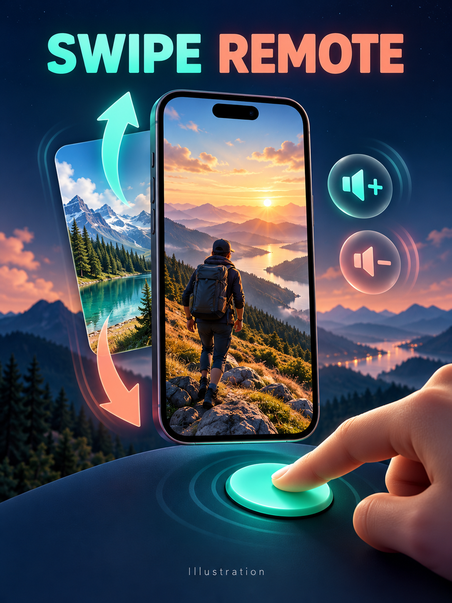

[English](README.md)

# 随手刷 Swipe Remote

把 AI Passport 变成 iPhone 无线短视频遥控器，用实体按键切换视频、调整音量。独立固件开机直接进入手机遥控，不包含 Mac 连接服务、桌面桥接程序或 Codex 助手。

## 开始使用

1. 将校验过的完整固件从 `0x0` 安装。会替换当前应用，可能清除已存配对和设置，无需全片擦除。
2. iPhone 打开“设置 → 辅助功能 → 触控 → 辅助触控”，开启辅助触控，关闭“拖移锁定”。
3. 在“辅助触控 → 设备 → 蓝牙设备”选择 **Passport Remote**，输入设备屏幕当前显示的六位码。
4. 等待 **CONNECTED**，在已解锁、竖屏的手机上打开抖音等短视频应用。

| 按键 | 功能 |
| --- | --- |
| 短按 UP | 下滑，上一条视频 |
| 短按 DOWN | 上滑，下一条视频 |
| 长按 UP | 音量单次增加 |
| 长按 DOWN | 音量单次减少 |
| 短按 OK | 指针回中，不点击 |
| 双击 OK | 弹出忘记配对确认；UP 确认，DOWN 取消 |
| 长按 OK | 打开或关闭设置指南 |

指南打开时按键不控制手机。本地忘记配对后，也要在 iPhone 上忽略 Passport Remote，再重新配对。设备保存一个绑定对象，断线后继续广播，重启后开始广播；何时完成重连由 iOS 决定，首次配对和辅助功能设置需要用户操作。运行时无需 Wi-Fi、账号、手机 App 或电脑。

## 兼容性与验证

底层滑动和音量逻辑已在先前的双应用版本中，由用户在 iPhone 15 Pro Max 上确认成功。独立版修改了应用界面、配对存储与广播服务，仍需单独安装和实机验收，不能把旧版结果记作新版通过。指针跟踪速度、屏幕方向、iOS 版本和目标应用均可能影响拖动效果；用户报告的抖音以外短视频应用尚未验证。

使用 ESP-IDF 5.5.3 运行 `./tools/validate.sh` 完成构建与主机测试。目标是现有 ESP32-C3、8 MB AI Passport 硬件。固件及匹配调试文件位于忽略的 `build/`，不要提交。使用隔离构建门禁，不要清理存放本地工具链的目录。

## 结构

- `main/phone_remote_main.c`：独立遥控界面、配对码、指南、确认提示及非阻塞按键队列。
- `main/phone_remote_model.c`：纯按键映射、完整鼠标拖动和松开报文。
- `main/phone_remote_ble.c`：经过认证的蓝牙 HID 鼠标和音量控制、持久配对、重连广播及过期连接保护；没有音乐切歌命令或桌面服务。
- `components/bsp`：保持原有板级支持。

继承的基线演示源码仅作参考，不会由本应用的 `main/CMakeLists.txt` 编译。分区布局和共享 BSP 均不变。固件发布遵循官方 AI Passport 社区流程；展示的封面为插画，不是设备截图。

## 构建检查点 — 2026-10-29

Build：PASS；Host tests：PASS；Device tests：NOT RUN（独立版）。Unverified：独立界面、首次配对、重连、安装后的抖音滑动与音量。完整固件 1,043,536 字节，SHA-256：`cfd3e64f160d015a05c48c2ac167c7ebf0be49083812ea486ee16987a1461221`。经过门禁校验的归档位于 `build/firmware/<该hash>/`。本次拆分没有刷入新固件。
